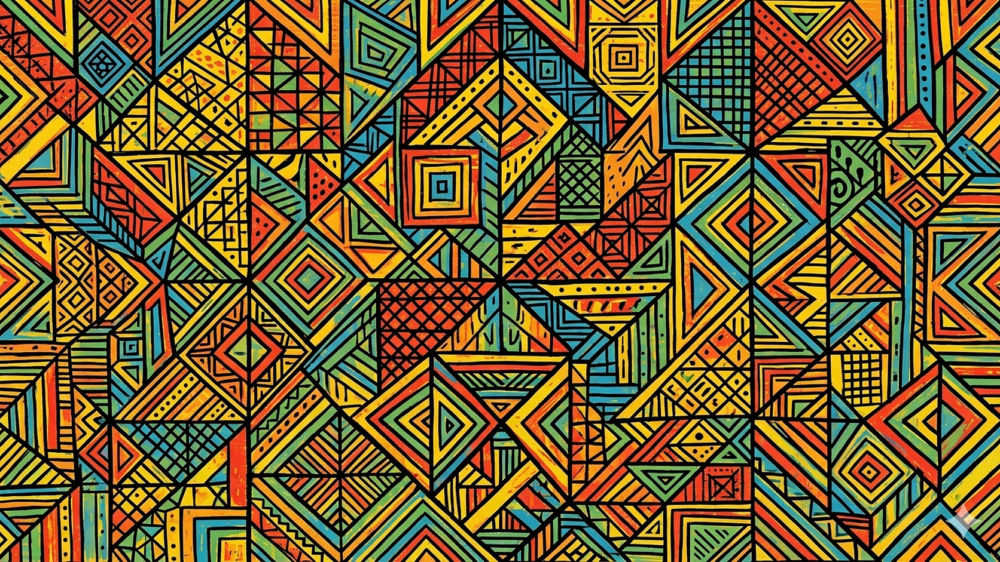

::: {.homepage-copy}

I’m building a math and personal website with Obsidian, Quarto, and GitHub Pages.

I am a math student interested in geometry, topology, dynamical systems, and machine learning.

Here is an explanation of my interests
[for a mathematical audience](#for-math-audience) or [for a lay audience](#for-lay-audience).

## Mathematical audience {#for-math-audience}

In sum, I interested in the following themes and areas, especially their interface.

1. Topology, geometry, and moduli
2. Equivalence, invariance, and functoriality
3. Distance, magnitude, and approximation
4. Deformation, variation, and singularity
5. Dynamics, evolution, and qualitative theory
6. Information, inference, and complexity

## Lay audience {#for-lay-audience}

I enjoy math about shapes, change, and prediction. Or more specifically

1. Shapes, spaces, and patterns
2. Change, motion, and transformation
3. Similarity, learning, and complexity

## Sections

- [About](about.qmd)
- [Notes](notes/index.qmd)
- [Posts](posts/index.qmd)

:::

<!-- Desktop: portrait crop at left. Mobile: full landscape image below text. -->

  

